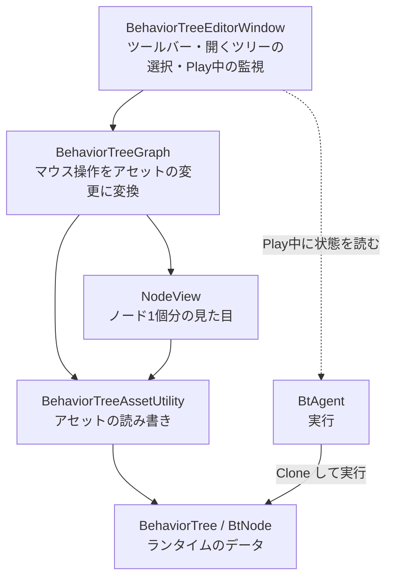
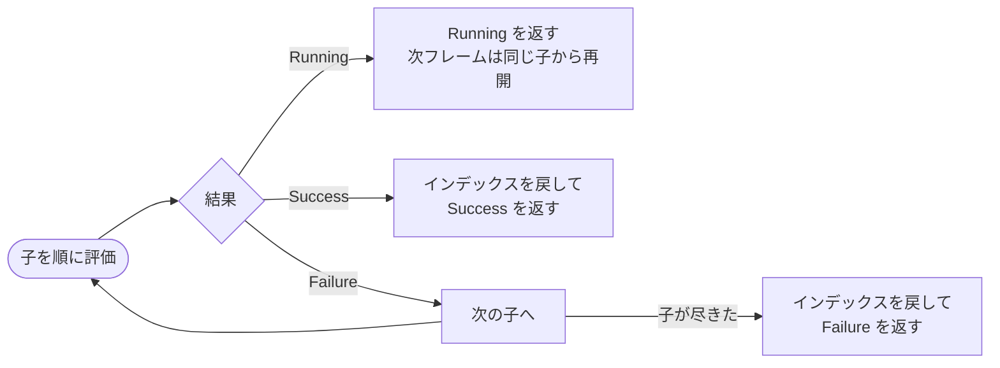
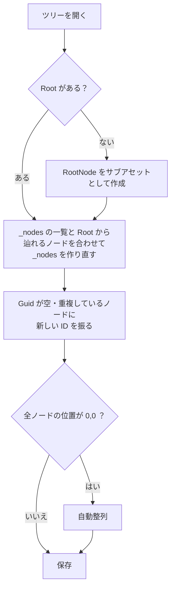
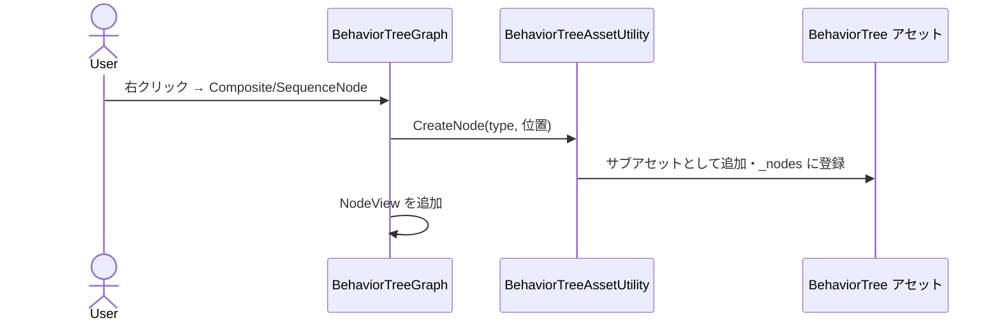
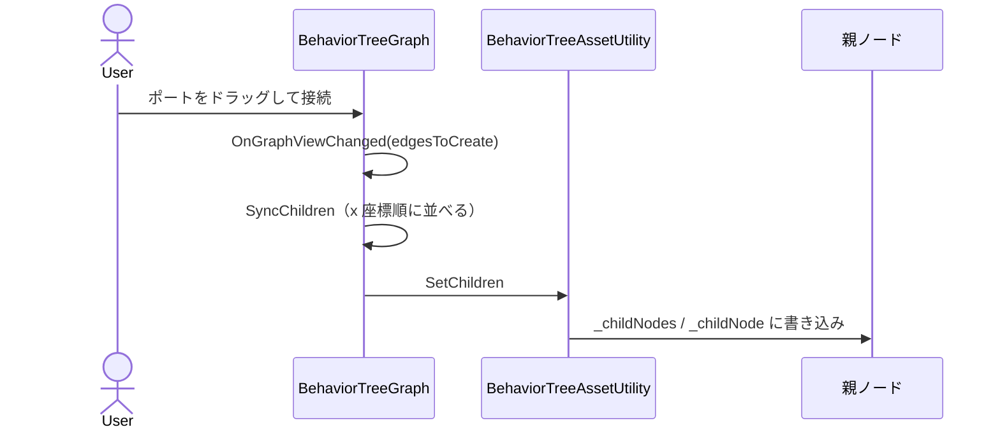
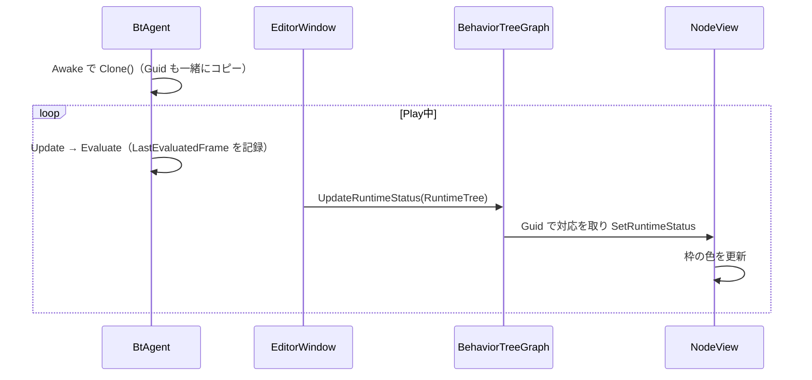

# BehaviorTree グラフエディタ 解説

BehaviorTree を **Window 上でグラフとして組み立て**、そのまま `BtAgent` で動かすためのエディタ拡張です。

## 目次

1. [使い方](#1-使い方)
2. [全体像](#2-全体像)
3. [ランタイム側の変更](#3-ランタイム側の変更)
4. [BehaviorTreeAssetUtility.cs](#4-behaviortreeassetutilitycs--アセットを読み書きする層)
5. [NodeView.cs](#5-nodeviewcs--ノード1個分の見た目)
6. [BehaviorTreeGraph.cs](#6-behaviortreegraphcs--マウス操作をアセットの変更に変換する)
7. [BehaviorTreeEditorWindow.cs](#7-behaviortreeeditorwindowcs--ウィンドウ)
8. [操作したときの流れ](#8-操作したときの流れ)
9. [注意点](#9-注意点)

---

## 1. 使い方

| 操作 | 方法 |
|---|---|
| ウィンドウを開く | `Window > Behavior Tree`、または BehaviorTree アセットをダブルクリック |
| ツリーを切り替える | ツールバーの欄にアセットを指定 / Project でアセットを選択 / `BtAgent` 付きの GameObject を選択 |
| ノードを追加 | 背景を右クリック → `Composite` / `Decorator` / `Condition` / `Action` |
| 親子をつなぐ | 親の下のポートから子の上のポートへドラッグ |
| パラメータを編集 | ノードをクリック → 普段の Inspector で編集 |
| 削除 | ノードかエッジを選んで `Delete` |
| 元に戻す | `Ctrl+Z` / `Ctrl+Y` |
| ツールバー | **保存** / **自動整列** / **全体表示** |

> [!TIP]
> Composite の子は **左にあるノードから順に評価** されます。順番を変えたいときはノードを左右に動かしてください。

### Play中の表示

ツリーを `BtAgent` に設定して Play すると、実行状態が枠の色で表示されます。

| 色 | 状態 |
|---|---|
| 🟨 黄 | Running（実行中） |
| 🟩 緑 | Success（成功） |
| 🟥 赤 | Failure（失敗） |
| 枠なし | 直近のフレームで評価されていない |

表示対象は、選択中の `BtAgent` を優先し、いなければ同じツリーを使っている `BtAgent` を自動で探します。

---

## 2. 全体像



> [!NOTE]
> 方針は **「グラフはアセットを映しているだけ」** です。
> グラフ専用の保存データは作らず、ランタイムがもともと使っている `_childNode` / `_childNodes` に直接書き込みます。
> そのため `BtAgent` 側の実行の仕組み（`Clone` → `Initialize` → `Evaluate`）は変わっていません。

### ファイル一覧

| ファイル | 種類 | 内容 |
|---|---|---|
| `ScriptableObjects/BtNode.cs` | 変更 | Guid・グラフ上の位置・最後に評価されたフレームを追加 |
| `ScriptableObjects/BehaviorTree.cs` | 変更 | 全ノードの一覧 `_nodes`、`ClonedNodes` を追加 |
| `BtAgent.cs` | 変更 | `SourceTree` / `RuntimeTree` を公開 |
| `Nodes/ConditionNode.cs` | 修正 | 子が未接続のときの null チェック |
| `Nodes/Composits/SelectorNode.cs` | 実装 | 仮実装だったものを実装 |
| `Mock/UIBuilder/NodeView.uss` | 変更 | Condition の色、実行状態の枠の色 |
| `Editor/BehaviorTreeAssetUtility.cs` | **新規** | アセットの読み書き |
| `Editor/NodeView.cs` | 書き直し | ノードの見た目 |
| `Editor/BehaviorTreeGraph.cs` | 書き直し | グラフの操作 |
| `Editor/BehaviorTreeEditorWindow.cs` | 書き直し | ウィンドウ |
| `Editor/MockBehaviorTree.Editor.asmdef` | **削除** | 理由は [注意点](#9-注意点) を参照 |

---

## 3. ランタイム側の変更

### `BtNode.cs`

```csharp
public int LastEvaluatedFrame { get; private set; } = -1;
public string Guid => _guid;

public NodeStatus Evaluate()
{
    LastEvaluatedFrame = Time.frameCount;   // 追加
    Status = OnUpdate();
    ...
}

[SerializeField, HideInInspector] private string _guid;
[SerializeField, HideInInspector] private Vector2 _graphPosition;
```

| 追加したもの | 役割 |
|---|---|
| `_guid` | グラフ上でノードを見分ける ID。`Instantiate` は SerializeField をそのままコピーするので、**複製されたノードも元と同じ Guid を持つ**。Play中に「この実行中ノードはグラフのどれか」を対応させるのに使う |
| `_graphPosition` | グラフ上の位置。ランタイムでは使わない |
| `LastEvaluatedFrame` | `Status` の初期値は `Running` なので、Status だけでは一度も評価されていないノードも「実行中」に見えてしまう。「直近のフレームで評価されたか」を判定するために記録する |

### `BehaviorTree.cs`

```csharp
[SerializeField, HideInInspector] private List<BtNode> _nodes = new List<BtNode>();
public IReadOnlyList<BtNode> ClonedNodes => _clonedNodes;
```

- **`_nodes`** … `_rootNode` から辿るだけでは **まだどこにも繋いでいないノード** が見つからない。グラフに表示するため、全ノードの一覧を別に持つ。実行には使わない。
- **`ClonedNodes`** … 実行用に複製したノードを、エディタが読めるように公開しただけ。

### `BtAgent.cs`

```csharp
public BehaviorTree SourceTree => _behaviorTree;   // 設定されている元のアセット
public BehaviorTree RuntimeTree => _runtimeTree;   // このエージェント用に複製したツリー
```

ウィンドウはこの2つを使って、「どのエージェントが今開いているツリーを使っているか」を探し、「そのエージェントの実行状態」を読みます。

### `ConditionNode.cs`

```csharp
clone._childNode = _childNode != null ? _childNode.Clone(clones) : null;
```

グラフで組んでいる途中は子が未接続のこともあり、そのまま Play すると例外になっていたので、`DecoratorNode` と同じ null チェックを入れました。

### `SelectorNode.cs`

常に `Success` を返す仮実装だったので、`SequenceNode` と対になる形で実装しました。



---

## 4. `BehaviorTreeAssetUtility.cs` — アセットを読み書きする層

ランタイムのフィールドは `private` / `protected` なので、エディタから直接は触れません。そこで **`SerializedObject` 経由で読み書き** しています。

> [!NOTE]
> この方法なら、ランタイムに編集用の public API を足さずに済みます。
> また `ApplyModifiedProperties()` を使うと **Undo にも自動で記録** されます。

### メソッド一覧

| メソッド | 役割 |
|---|---|
| `GetKind(Type)` | 継承元から Root / Composite / Decorator / Condition / Action を判定。子をいくつ持てるか、ポートを作るかはこれで決まる |
| `GetCreatableNodeTypes()` | `TypeCache` で `BtNode` を継承した具象クラスを集める。**新しいノードクラスを書けば右クリックメニューに自動で出る** |
| `GetChildren` / `SetChildren` | Composite なら `_childNodes`、それ以外なら `_childNode` を読み書き |
| `GetPosition` / `SetPosition` | `_graphPosition` を読み書き |
| `CreateNode` | ノードを作り、Guid と位置を入れ、**ツリーのサブアセットとして追加** して `_nodes` に登録 |
| `DeleteNode` | `_nodes` から外す。ツリーのサブアセットなら破棄し、別ファイルのノードアセットはファイルを残す |
| `EnsureSetup` | ツリーを開いたときの下準備（下記） |
| `AutoLayout` | 木の形に並べ直す（下記） |

### ノードの種類と子の数

| 種類 | 継承元 | 書き込み先 | 子の数 |
|---|---|---|---|
| Root | `RootNode` | `_childNode` | 1 |
| Composite | `CompositeNode` | `_childNodes` | 複数 |
| Decorator | `DecoratorNode` | `_childNode` | 1 |
| Condition | `ConditionNode` | `_childNode` | 1 |
| Action | 上記以外 | — | 0 |

### `EnsureSetup` の流れ

既存の `MockBehaviorTree` のように、手作業で組んだツリーもそのまま開けるようにするための処理です。



> [!TIP]
> Guid の重複チェックは、Ctrl+D でノードアセットを複製した場合への対策です。

### `AutoLayout` の考え方

1. 葉ノードを左から順に一定間隔で並べる
2. 親は「最初の子と最後の子のちょうど中間」に置く
3. y 座標は深さで決まる
4. 未接続のノードはその右側に並べる

---

## 5. `NodeView.cs` — ノード1個分の見た目

コンストラクタで `BtNode` を受け取り、`GetKind` の結果で形を決めます。

| 種類 | 入力ポート（上） | 出力ポート（下） | 削除 |
|---|---|---|---|
| Root | なし | Single | **不可** |
| Composite | あり | **Multi** | 可 |
| Decorator | あり | Single | 可 |
| Condition | あり | Single | 可 |
| Action | あり | なし | 可 |

### 主な処理

| メンバー | 役割 |
|---|---|
| `viewDataKey = Guid` | ビューとノードを結びつける |
| `OnSelected()` | `Selection.activeObject = NodeAsset` にして、**普段の Inspector でパラメータを編集** できるようにする |
| `SetRuntimeStatus()` | 直近1フレーム以内に評価されていれば、Status に応じた USS クラス（`running` / `success` / `failure`）を付ける |
| `GetDisplayName()` | 型名の末尾の "Node" を省いて表示。別ファイルの既存アセットで、アセット名が型名と違う場合は2行目にアセット名も出す |

---

## 6. `BehaviorTreeGraph.cs` — マウス操作をアセットの変更に変換する

### `PopulateView(tree)` — アセットからグラフを作る

1. `graphViewChanged` のイベントを **いったん外して** から既存の要素を全部消す
2. `EnsureSetup` → 全ノードの `NodeView` を作成 → `GetChildren` を元にエッジを張る
3. イベントを付け直す

> [!WARNING]
> 手順1でイベントを外さないと、要素を消す操作が「ユーザーがノードを削除した」と扱われ、**アセットからも消えてしまいます**。

### `OnGraphViewChanged` — グラフの変更をアセットに反映する

GraphView はノードの削除・接続・移動を、このコールバック1つで通知してきます。

| 変更 | 処理 |
|---|---|
| エッジの追加・削除 | その親ノードを「子を作り直す対象」に入れる |
| ノードの移動 | 位置を保存。Composite は **横の位置が評価順** なので、動かしたノードの親も作り直す対象に入れる |
| ノードの削除 | `DeleteNode` |

最後に全体を `Undo.CollapseUndoOperations` でまとめ、**Ctrl+Z 1回で戻る** ようにしています。

### `SyncChildren` — 子の作り直し

コールバックの時点では、

- 追加されるエッジは **まだポートに繋がっていない**
- 削除されるエッジは **まだ繋がったまま**

という状態です。そこで次のように計算し、x 座標で並べてから `SetChildren` します。

```
子 = 今の接続 − 削除予定のエッジ + 追加予定のエッジ
```

### `GetCompatiblePorts` / `WouldCreateCycle` — 循環の防止

A → B → A のような循環を作ると、`Clone()` が無限に再帰してしまいます。接続しようとしている子が親の祖先にあたる場合は、接続先の候補から外しています。

### `UpdateRuntimeStatus` — Play中の状態表示

実行中ツリーの `ClonedNodes` を「Guid → ノード」の辞書にして、各 `NodeView` に対応するノードを渡します。

### `BuildContextualMenu` — 右クリックメニュー

| 右クリックした場所 | 出るメニュー |
|---|---|
| 背景（`evt.target == this`） | ノード作成メニュー + 標準メニュー |
| ノードの上 | 標準メニュー（Delete など）のみ |

---

## 7. `BehaviorTreeEditorWindow.cs` — ウィンドウ

### ツリーの開き方

| きっかけ | 処理 |
|---|---|
| `Window/Behavior Tree` | ウィンドウを開く |
| アセットのダブルクリック | `[OnOpenAsset]` でそのツリーを開く |
| ツールバーの ObjectField | 指定したツリーを開く |
| BehaviorTree アセットを選択 | `OnSelectionChange` で切り替え |
| `BtAgent` 付きの GameObject を選択 | そのエージェントのツリーに切り替え、表示対象にもする |

### 主な処理

| 処理 | 内容 |
|---|---|
| `[SerializeField] _tree` | 再コンパイル後も、開いていたツリーを覚えておく |
| `SetTree` | `EditorUtility.IsPersistent` で、Play中の複製ツリー（アセットではないもの）は編集対象から外す |
| `Update` | Play中だけ動く。`FindDebugAgent` で表示対象を決め、その状態をグラフに流す |
| `FindDebugAgent` | 選択中のエージェントを優先。いなければ同じツリーを使う `BtAgent` を探す。全オブジェクトの検索は重いので **0.5秒に1回まで** |
| 保存 | 変更はその場で反映される。ディスクへの書き込みは「保存」ボタンとウィンドウを閉じたとき。別ファイルのノードアセットも保存されるよう `AssetDatabase.SaveAssets()` を使う |
| Undo / Redo | `Undo.undoRedoPerformed` を受けたらグラフを作り直し、アセットとの食い違いを防ぐ |

---

## 8. 操作したときの流れ

### ノードを追加する



### ノードをつなぐ



### Play して状態を表示する



---

## 9. 注意点

> [!IMPORTANT]
> **`MockBehaviorTree.Editor.asmdef` を削除しました。**
> asmdef からは Assembly-CSharp にある `BtNode` などを参照できないためです。エディタのスクリプトは `Assembly-CSharp-Editor` に含まれるようになります。

> [!WARNING]
> **既存の `MockBehaviorTree` / `CenterThenDonut` を開くと、アセット自体に書き込みが入ります。**
> Root から辿ったノードを `_nodes` に取り込み、自動整列します。このとき別ファイルの各ノードアセット（`SO/BehaviorTree/Nodes/...`）にも位置と ID が保存されます。
> グラフで削除しても、別ファイルのノードアセットはツリーから外れるだけで、ファイルは消えません。

> [!NOTE]
> `SequenceNode` は Failure のとき `_index` をリセットしないため、次に評価されると失敗した子から再開します。意図した動きか確認してください（今回は変更していません）。
